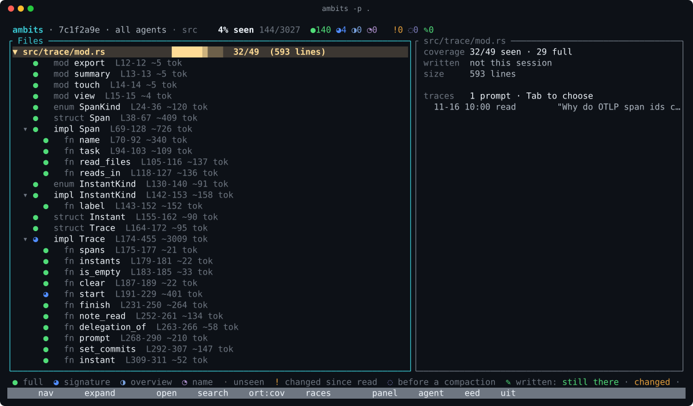
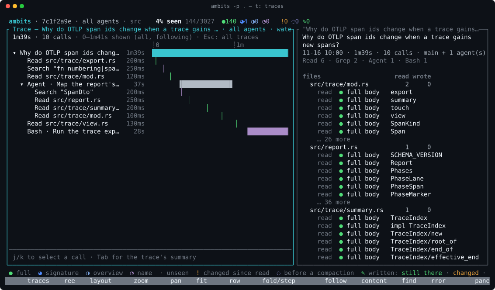

# Ambits

[](https://github.com/joshLong145/ambits/actions/workflows/ci.yml)
[](https://codecov.io/gh/joshLong145/ambits)

**A code-reading tool for AI agents, and a memory of what they have read.**

Coding agents read whole files to find one function, re-read code they already know, and lose all of it when the context window compacts. ambits answers in symbols instead of files, records every symbol an agent reads and at what depth, and hands that history back after a compaction. Output is plain text and JSON; session ingestion is built for Claude Code.



## Quick start

```bash
cargo install ambits                # or a prebuilt binary from Releases
ambits skill install                # teach Claude Code to use ambits
ambits hook install --project .     # restore read history after every compaction
ambits -p .                         # watch the session live
```

## For the agent

**Search, with every hit attributed to a symbol**, using ripgrep's flags (or GNU grep's via `ambits grep`). The bracket names the enclosing symbol and how deeply this session has read it:

```console
$ ambits -p . rg 'fn is_binary' -t rust
src/search.rs:410:1:[full is_binary] fn is_binary(buf: &[u8]) -> bool {
```

**Find callers** from the grammar's call nodes, never from comments or strings:

```console
$ ambits -p . callers centered_rect
centered_rect — 2 call sites in 2 callers
  src/ui/alignment.rs::render  (src/ui/alignment.rs:15)
  src/ui/compaction.rs::render  (src/ui/compaction.rs:15)
```

**Read one symbol, not the file**, by id or content hash, as JSON:

```bash
ambits -p . show 'src/app.rs::App/process_compaction'
```

**Recall what it has already read**, with line ranges that stay correct after edits:

```console
$ ambits -p . restore-context
### src/digest.rs — 47 symbols (~13.7k tok)
grouped:64-84, symbol_label:104-119, fit_names:126-141, …
```

## For you

**The TUI** tails the session live: the symbol tree shaded by read depth, per-agent filtering for subagents, compactions, and the files each agent wrote. Press `t` for traces: each prompt's tool calls on a timeline, subagents nested under the call that started them.



**Coverage** for scripts and CI:

```bash
ambits -p . --coverage --format json | jq '.totals.full_percent'
```

**Traces and reports** for OpenTelemetry backends, Perfetto, or a single HTML page:

```bash
ambits -p . trace > session.otlp.json
ambits -p . trace --format chrome > session.trace.json   # ui.perfetto.dev
ambits -p . report --format html > session.html
```

**Agent writes**: when an agent last wrote a file or symbol, and whether that version is still on disk:

```bash
ambits -p . touched src/search.rs
```

**Snapshots and sharing**: a session's reads and writes as content-addressed history, shared through any directory:

```bash
ambits -p . snapshot && ambits -p . remote add origin /mnt/team/ambits && ambits -p . push
ambits -p . fetch && ambits -p . restore origin/<session>   # on another machine
```

## Languages

| Backend | Languages |
|---|---|
| tree-sitter (default) | Rust, Python, TypeScript (`.ts`), Java, Markdown |
| [Serena](https://github.com/oraios/serena) (`--serena`) | Anything Serena supports |

Search covers every text file; a file no parser handles has no symbols.

## Documentation

The **[wiki](https://github.com/joshLong145/ambits/wiki)** has the full reference: [Getting Started](https://github.com/joshLong145/ambits/wiki/Getting-Started), [CLI Reference](https://github.com/joshLong145/ambits/wiki/CLI-Reference), [TUI](https://github.com/joshLong145/ambits/wiki/TUI), [Traces](https://github.com/joshLong145/ambits/wiki/Traces), [Reports](https://github.com/joshLong145/ambits/wiki/Reports), [Snapshots](https://github.com/joshLong145/ambits/wiki/Snapshots), [Sharing](https://github.com/joshLong145/ambits/wiki/Sharing), [Configuration](https://github.com/joshLong145/ambits/wiki/Configuration) and [Architecture](https://github.com/joshLong145/ambits/wiki/Architecture). Its source is [`docs/wiki/`](docs/wiki/); edit it there.

## Building from source

Requires Rust 1.88+.

```bash
cargo build --release
cargo test
```

The images above are drawn by the real TUI from a scripted session; `cargo run --manifest-path tools/readme-images/Cargo.toml` regenerates them after a release build.
